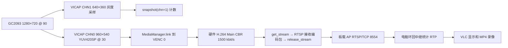

# M3 图传实现说明

本说明对应方案 7 版本 2 的代码。版本 1 的实板数据和版本 2 的电脑对照在《M3 VICAP 通道限帧诊断》。灰度采样和完整检测算法并行是先后两项验收。

## 数据流

| 环节 | 项目调用及参数 |
| --- | --- |
| 传感器与通道 | `Sensor(width=1280, height=720, fps=90)` 后 `reset()`。CHN0 `set_framesize(width=960, height=540, alignment=12)` 和 `set_pixformat(Sensor.YUV420SP)`，再 `_set_chn_fps(chn=0, fps=30)`。CHN1 配置 640×360 `Sensor.GRAYSCALE`，沿用输入帧率。`sensor.run()` 把属性提交给 VICAP。 |
| 硬件绑定 | `Encoder.SetOutBufs(0, 8, 960, 540)`。`MediaManager.link(sensor.bind_info()['src'], (VIDEO_ENCODE_MOD_ID, VENC_DEV_ID, 0))`，随后 `MediaManager.init()`。 |
| 编码器 | `Encoder.Create` 请求 H.264 Main，CBR 1500 kbit/s、GOP 30、输入和输出各 30 fps。`Encoder.Start` 先于 `sensor.run()`。 |
| 编码包 | 现有 `send_one` 把 `pack_cnt` 设为 1，调用 `kd_mpi_venc_get_stream`。方案 7 用非阻塞取包，先从 CHN1 `snapshot(chn=1, timeout=25)`。成功后用物理地址、长度和 `pts // 1000` 调用 `rtspserver_sendvideodata_byphyaddr`，在 `finally` 中释放本次取得的 stream。 |
| RTSP 和电脑 | `rtspserver_init(8554)`、`rtspserver_createsession("hcv", media_h264, False)`、`rtspserver_start()`。唯一板端 RTSP/TCP 连接由电脑本地中继建立。VLC 缓冲 200 ms，播放并封装 MP4。 |
| 清理 | `sensor.stop()`、停止并释放 RTSP、释放 link 引用、`Encoder.Stop`、`Encoder.Destroy`、`MediaManager.deinit()`。 |

板端由一个有界 MicroPython 循环交替采样 CHN1 和提交编码包。它没有额外的 Python 推流线程。RTSP 库负责网络侧事件循环。电脑中继用一个线程在板端连接与 VLC 之间转发，按 RTP 帧接收时刻统计包数和字节数。方案 7 先在同一 AP 和端口跑纯 TCP 对照，关闭对照套接字后再初始化媒体。

## 缓冲区

以下大小由固件源码的 4096 字节对齐公式和方案分辨率计算。传感器输入在线模式的配置日志显示 `buffer_num=4, buffer_size=0`。驱动的内部队列占用未实测。

| 缓冲区 | 数量及单块大小 |
| --- | --- |
| VICAP CHN0 | 固件默认 6 块。YUV420SP 的 `960×540×3/2` 对齐后每块 778,240 B。 |
| VICAP CHN1 | 固件默认 6 块。固件用 YUV420SP 底层存储映射灰度，`640×360×3/2` 对齐后每块 348,160 B。 |
| VENC 码流池 | 8 块，`960×540×3/4` 对齐后每块 389,120 B。 |
| Python 输出描述符 | 当前预分配一份 `k_venc_stream` 和一个 `k_venc_pack` 的空间，长度使用固件的 `uctypes.sizeof`。 |
| RTSP 内部队列 | SDK 参考实现有原始包队列和帧队列。本板实际库版本和缓冲区上限尚未取证。 |

VICAP 默认值、灰度映射和池公式来自本固件对应的 [sensor.py](https://github.com/kendryte/canmv_k230/blob/a7de1c8b9a8eb84238fc6a9880d903c308079b30/port/builtin_py/media/sensor.py)。编码池来自 [vencoder.py](https://github.com/kendryte/canmv_k230/blob/a7de1c8b9a8eb84238fc6a9880d903c308079b30/port/builtin_py/media/vencoder.py)。

## 与官方示例的差异

- 官方示例从默认传感器取一路 1280×720 YUV420SP。项目选 720p90 传感器模式并配置两路，给检测保留高帧率，缩小图传尺寸并单独限帧。官方示例和项目都将 CHN0 绑定到 VENC 并配置 8 块编码缓冲。
- 官方示例用独立 Python 线程取流，在主线程等待并停止。项目在一次有截止时间的循环中采两路，让逐秒统计和回收路径可复核。物理地址接口避免在 Python 层映射并复制每个编码包，仍需确认固件库内部数据生命周期。
- 官方 `Encoder.GetStream` 先调用 `kd_mpi_venc_query_status`，按 `status.cur_packs` 分配描述符，并逐个发送返回的包。项目直接调用 MPI，当前只有一个预分配描述符，减少了每次取流分配但没有覆盖多包输出。公开 SDK 的 C 示例同样按 `cur_packs` 取包。已确认需要按实际包数保留所有描述符。公开样例未定义描述符数量小于实际包数时，是报错、保留还是丢弃。对色块及停流的因果关系仍需取包修改后的实测。后续记录每次查询和实际返回的包数，并按固件 `I_FRAME`、`P_FRAME`、`HEADER` 分类。`I_FRAME` 计数与 NAL 层确认的 IDR 数分别报告。[官方板端示例](data/M3/official-examples-20261122/rtsp_server.py) · [SDK 多包示例](https://github.com/kendryte/k230_sdk/blob/7e302f733311d284be255f0d81d3463b6ae6ee6d/src/big/mpp/userapps/sample/sample_venc/sample_venc.c)
- 官方示例固定传 `1000`，项目传编码包的 PTS 毫秒值。`RtspServer.c` 的可见代码把参数名标为 `timestamp`，原样传给 `RtspServer_SendVideoData_Byphyaddr`。SDK 公开 RTSP 实现把参数存到原始包，Live555 消费原始包时用 `gettimeofday()` 生成呈现时刻。这可以解释参考实现接受常数的行为。当前还缺少本板链接库与公开 SDK 实现一致的证据，保留现有参数，等有证据再确定调整。[本固件绑定](https://github.com/kendryte/canmv_k230/blob/a7de1c8b9a8eb84238fc6a9880d903c308079b30/port/multi_media/RtspServer.c) · [SDK 帧时间戳实现](https://github.com/kendryte/k230_sdk/blob/7e302f733311d284be255f0d81d3463b6ae6ee6d/src/big/mpp/middleware/src/rtsp_server/LiveFrameSource.cpp)

## 工程对照

| 实现 | 传感器和推流配置 |
| --- | --- |
| 河南队 | 30 fps 传感器，固件 v1.6，经 LCD 回写后按 12 fps、800 kbit/s、GOP 12 编码。 |
| 湖北队 | 1920×1080@60 传感器，640×360@60 推流，1 Mbit/s、GOP 10。 |
| AkezI-T | 30 fps，使用第二块 K230 专门做图传。 |
| H-CV | 同一块板 720p90，CHN0 图传目标 30 fps，CHN1 灰度检测目标 90 fps。 |

队伍配置来自 [Issue #6 对照记录](https://github.com/Echoall/H-CV/issues/6#issuecomment-7154409815)，其中湖北队参数已与 [锁定版本](https://github.com/VincentttWang/NUEDC_2026/blob/ed079e5/2026H/firmware_G3507/k230/rtsp_camera_stream.py)核对。这些记录未覆盖项目的 90 fps 同板检测与推流组合。
